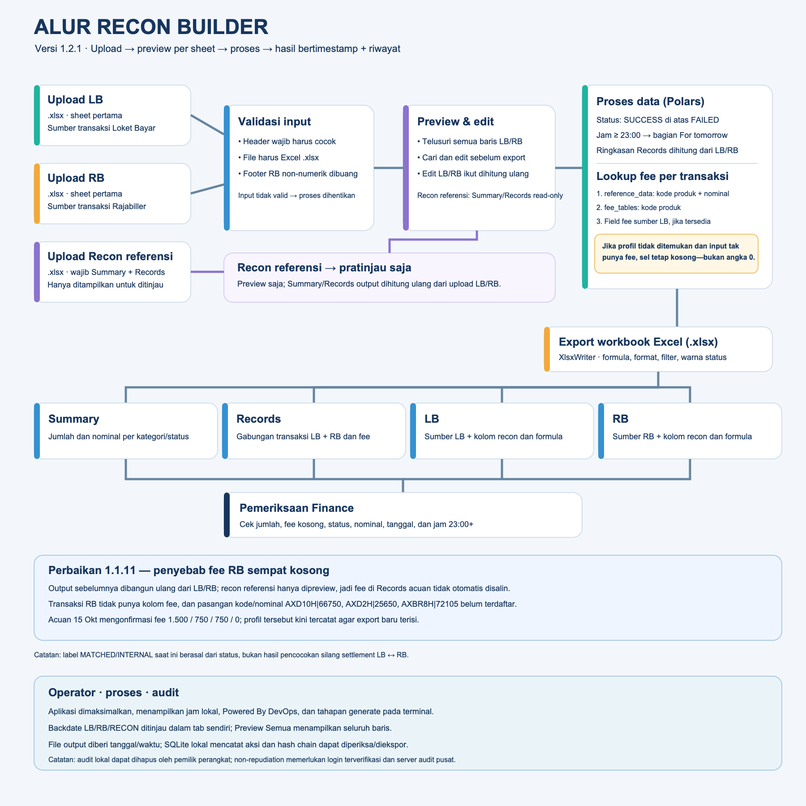

# Panduan Finance — Recon Builder

Panduan ini menjelaskan cara menyiapkan file, menjalankan aplikasi, dan
memeriksa hasil export. Aplikasi hanya memproses workbook Excel `.xlsx`.

## Gambaran alur

Versi JPG tersedia di [flow-recon-finance.jpg](flow-recon-finance.jpg).
File sumber diagram: [flow-recon-finance.svg](flow-recon-finance.svg).

Alur singkat: **Upload LB + RB + file recon referensi → validasi → preview/
koreksi → proses data → export Excel → periksa Summary, Records, LB, dan RB**.
Jumlah baris, tanggal, nominal, dan nilai lain diambil dari file yang diupload
setiap kali proses berjalan. Data pada sheet Summary dan Records dari file recon
referensi ditampilkan untuk ditinjau; Summary dan Records pada output dihitung
ulang dari upload LB/RB.

## Menjalankan aplikasi

1. Buka **ReconBuilder.app** (atau jalankan `python3 app.py` dari source).
2. Pada **Upload LB**, pilih workbook Loket Bayar berformat `.xlsx`; tunggu
   preview selesai dimuat.
3. Pada **Upload RB**, pilih workbook Rajabiller berformat `.xlsx`; tunggu
   preview selesai dimuat.
4. Pada **Upload Recon**, pilih file recon `.xlsx` yang memiliki sheet
   **Summary** dan **Records**. Kedua sheet dimuat sebagai referensi dan dapat
   ditinjau melalui tab **Recon · Summary** dan **Recon · Records**.
5. Field **File Backdate (opsional)** disediakan untuk rencana alur Backdate.
   Pada versi 1.1.14, upload ini baru tersedia pada form dan belum diproses.
   Jika Backdate dipilih, Generate akan dihentikan dengan pemberitahuan agar
   file tersebut tidak terabaikan. Kosongkan field ini untuk melanjutkan proses
   End Date/reguler.
6. Tinjau tab **Preview LB** dan **Preview RB**. Preview dapat menelusuri
   seluruh baris file: pilih jumlah baris per halaman lalu gunakan
   **Sebelumnya/Berikutnya**. Gunakan **Cari seluruh data** untuk menemukan
   nilai di semua kolom, termasuk transaksi pada halaman lain.
7. Untuk koreksi LB/RB, pilih sel lalu klik **Edit sel terpilih**, atau klik
   ganda sel. Ubah nilai, lalu tekan **Enter** atau pindah fokus untuk
   menerapkan; **Esc** membatalkan. Perubahan pada baris preview ikut
   diterapkan ke export. Baris lain tetap berasal dari file upload.
   Preview recon bersifat referensi dan tidak dapat diedit.
8. Tentukan lokasi dan nama file output yang berakhiran `.xlsx`.
9. Klik **Generate Recon** dan tunggu pesan sukses.
10. Buka file output. Periksa sheet **Summary** dan **Records** yang dihitung
   dari upload LB/RB, lalu telusuri data sumber dan formula recon pada sheet
   **LB** dan **RB**.

Dialog pemilihan file dibatasi ke workbook `.xlsx`. Format `.xls`, `.xlsm`,
`.csv`, PDF, dan file selain Excel tidak didukung. Sheet pertama pada setiap
workbook yang dipilih akan dibaca.

## Format sumber yang diperlukan

Gunakan template/export standar dengan nama header berikut pada sheet pertama.
Header harus cocok; jangan mengganti nama kolom wajib.

**LB — Loket Bayar**

`Tanggal`, `Operator`, `Nama`, `Idpel`, `Produk`, `Periode`, `Status`,
`No. Reff (SN)`, `Lembar`, `Tagihan`, `Denda`, `Admin`, `Harga`, `Fee Loket`,
`Fee Bulan`, `Total`, `Ref ID`.

**RB — Rajabiller**

`No`, `ID Trx`, `Tanggal`, `Kode Produk`, `No Pelanggan-1`,
`No Pelanggan-2`, `No Pelanggan-3`, `No Pelanggan-4`, `Via`, `SN`, `Ref`,
`Status`, `Nominal`.

Baris footer/ringkasan RB yang kolom `No`-nya kosong atau bukan angka
dilewati. Baris transaksi dengan nomor valid tetap diproses. Data tidak perlu
memiliki jumlah baris atau tanggal tertentu.

## Isi file hasil

| Sheet | Isi | Cara menggunakan |
|---|---|---|
| `Summary` | Ringkasan jumlah dan nominal transaksi per kategori/status, dihitung ulang dari upload LB/RB. | Gunakan untuk pemeriksaan awal, lalu telusuri transaksi di `Records`. |
| `Records` | Daftar gabungan baris LB dan RB, diurutkan berdasarkan tanggal, dihitung ulang dari upload LB/RB. | Gunakan filter header untuk mencari produk, referensi, status, atau biller. |
| `LB` | Data sumber LB dan kolom recon/formula sesuai layout acuan. | Bandingkan kolom hasil recon dengan data sumber pada bagian LB. |
| `RB` | Data sumber RB dan kolom recon/formula sesuai layout acuan. | Bandingkan kolom hasil recon dengan data sumber pada bagian RB. |

Header dibekukan ketika scroll; `Records` memiliki filter, dan format angka,
tanggal, warna, serta lebar kolom mengikuti workbook acuan agar nilai mudah
dibaca. Nominal transaksi tetap berasal dari input, sedangkan fee menggunakan
profil kode produk dan nominal bila tersedia. Untuk kombinasi baru, aplikasi
menggunakan tabel fee fallback, lalu field fee LB jika tersedia.
Untuk transaksi RB pada acuan 15 Oktober 2026, AXD10H nominal 66.750,
AXD2H nominal 25.650, dan AXBR8H nominal 72.105 menggunakan fee
1.500 / 750 / 750 / 0 (Total / Customer / LST / Margin).
Penyebab fee transaksi tersebut sebelumnya kosong adalah kombinasi kode produk
dan nominalnya belum memiliki profil fee. File RB mentah hanya memiliki kolom
nominal/status, bukan kolom fee; sementara workbook recon referensi hanya
ditampilkan sebagai preview dan tidak disalin menjadi sumber data output.
Karena itu nilai fee dari sheet `Records` referensi tidak otomatis masuk ke
export baru. Sejak versi 1.1.11 ketiga kombinasi tersebut sudah tercatat di
profil aplikasi. Untuk produk/nominal baru yang belum punya profil, jangan
menganggap sel kosong berarti fee nol; minta Finance mengonfirmasi nilai dan
tambahkan profil sebelum memakai hasil sebagai laporan final.

Pada sheet `LB` dan `RB`, baris total ditempatkan langsung setelah kelompok
`SUCCESS` dan setelah kelompok `FAILED`, sejajar dengan kolom angka pada
contoh recon. Tiga baris kosong memisahkan total SUCCESS dari transaksi
FAILED. Amount dan empat kolom fee dijumlahkan masing-masing untuk statusnya;
transaksi For tomorrow juga ikut dihitung. Baris total mengikuti contoh:
kolom pertama menunjukkan Amount + Margin Biller, kemudian Amount, Total Fee,
Customer Fee, LST Fee, dan Margin Biller. Nilai transaksi per baris tidak
berubah.

Pada sheet `LB` dan `RB`, transaksi otomatis diurutkan: semua `SUCCESS` tampil
lebih dahulu, diikuti semua `FAILED`, lalu status lain bila ada. Dalam setiap
kelompok status, tanggal/waktu diurutkan dari yang paling awal. Total SUCCESS
dan FAILED muncul setelah masing-masing kelompok, dengan tiga baris kosong
sebagai jarak setelah total SUCCESS. Baris kedua tetap menampilkan jumlah
transaksi `SUCCESS` dan `FAILED` untuk tabel Current Day; dropdown filter di
header `Transaction Status` atau `Recon Result` dapat digunakan untuk
pemeriksaan lebih lanjut. Warna hijau untuk `SUCCESS` dan merah untuk
`FAILED` hanya diterapkan pada nilai di kolom `Transaction Status` pada blok
recon Current Day dan For tomorrow; kolom status mentah sumber serta sel lain
tidak diberi warna.

Semua tanggal yang ada di file LB dan RB diproses otomatis; aplikasi tidak
membatasi jumlah hari. Transaksi pukul 23:00–23:59 tidak ditampilkan di tabel
recon dan blok data sumber **Current Day**. Transaksi tersebut ditampilkan pada
bagian recon dan data sumber **For tomorrow because different time**.
Jadi yang dipindahkan adalah tampilannya di tabel recon, bukan penghapusan
transaksi dari data sumber. Baris total per status mencakup seluruh transaksi
sumber, termasuk transaksi pada bagian For tomorrow.

Kolom `Datetime` pada `Records`, `LB`, dan `RB` disimpan sebagai nilai tanggal/
waktu Excel, bukan teks. Untuk mengambil transaksi hari ini pukul 23.00 sampai
23.59, filter tanggal hari ini dan batas waktu **23:00:00–23:59:59**. Nilai
timestamp tetap menyertakan jam, menit, dan detik.

Bagian **For tomorrow because different time** pada sheet `LB`/`RB` menampilkan
transaksi dari tanggal mana pun yang waktunya **23:00:00 atau lebih**. Data
sebelum pukul 23.00, termasuk pukul 00.00, tidak dimasukkan ke bagian tersebut.

File recon referensi hanya dibaca untuk memuat dan meninjau sheet `Summary`
serta `Records`. Isinya tidak menggantikan hasil; sheet `Summary` dan `Records`
pada output selalu dihitung ulang menggunakan upload LB/RB yang sedang diproses.

Preview menampilkan data dalam halaman agar file besar tetap mudah ditinjau.
Pencarian mencakup semua baris, bukan hanya halaman aktif. Perubahan yang
disimpan di preview memengaruhi baris yang sama pada sheet input dan hasil
gabungan; nilai perhitungan terkait akan dibuat ulang oleh exporter. File
sumber tidak dimodifikasi.

## Pemeriksaan sebelum memakai hasil

1. Pastikan keempat sheet tersedia dan jumlah transaksi sesuai file sumber
   (footer RB yang dibuang tidak dihitung).
2. Cocokkan beberapa referensi, tanggal, status, dan nominal antara sumber dan
   sheet `LB`/`RB`.
3. Periksa fee untuk kode produk/nominal yang baru atau belum ada di profil.
4. Periksa nilai Summary, terutama transaksi berstatus gagal/refund.
5. Simpan file sumber dan hasil sesuai kebijakan penyimpanan Finance.

## Batasan penting klasifikasi recon

Versi saat ini **belum melakukan pencocokan pasangan transaksi LB terhadap RB**
berdasarkan `Ref`, `Ref ID`, nominal, atau kunci gabungan lain. Status transaksi
dinormalisasi menjadi `SUCCESS` atau `FAILED`; status sukses menghasilkan
`MATCHED`, sedangkan status selain sukses menghasilkan `INTERNAL`. Karena itu,
label `MATCHED`/`INTERNAL` pada versi ini bukan bukti bahwa transaksi telah
dicocokkan silang antar-biller. Minta aturan matching Finance (kunci transaksi,
toleransi nominal/waktu, dan perlakuan refund) sebelum menggunakan output untuk
keputusan settlement.

## Jika proses gagal

- **Header wajib tidak ditemukan:** pastikan memilih file sumber yang benar dan
  kembalikan nama header ke format standar.
- **File tidak terbaca:** pastikan file benar-benar `.xlsx`, tidak rusak, dan
  dapat dibuka di Excel/LibreOffice.
- **Output gagal dibuat:** tutup file output jika sedang terbuka, lalu pilih
  lokasi yang dapat ditulis dan nama berakhiran `.xlsx`.
